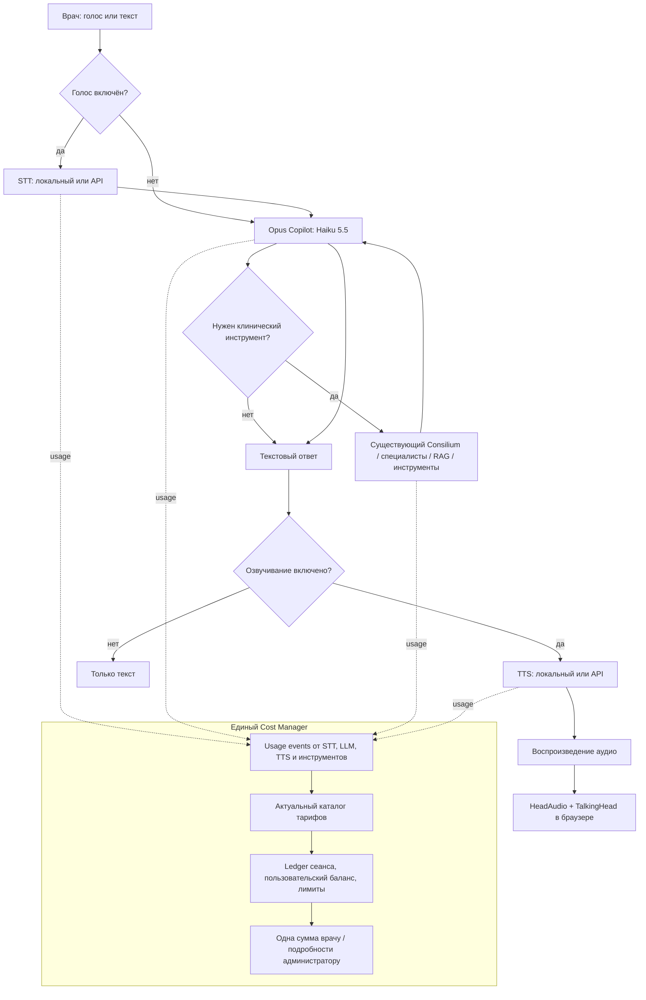

# Doctor Opus Clinical Intelligence — Copilot Avatar + Unified Cost Manager

**Передача Codex:** 18 ноября 2026 г.  
**Проект:** Doctor Opus Clinical Intelligence / Consilium  
**Репозиторий:** https://github.com/vasiliys961/consilium  
**Статус:** проектное задание для отдельного опционального модуля. **Не прерывать W5** и не внедрять в рабочие клинические маршруты до завершения клинической приёмки.

## 0. Цель

Создать недорогого голосового Copilot с локально анимируемой 3D-головой и единым учётом расходов на:

- распознавание речи (STT);
- языковую модель Copilot;
- локальный либо облачный синтез речи (TTS);
- анимацию аватара;
- вызываемые Copilot клинические модели, инструменты, поиск/RAG;
- при необходимости — расчёт инфраструктурной себестоимости.

Врач видит **одну цену сеанса / общий баланс**; администратор видит разбивку фактической и оценочной себестоимости по поставщикам и вызовам. Анимация не должна требовать подписки на HeyGen и поминутного облачного рендеринга.

## 1. Выбор «головы»

**На прототип:** JavaScript/Three.js `@met4citizen/talkinghead` + штатный тестовый `brunette.glb`, только в среде разработки после проверки лицензии самого ассета. 

**Синхронизация губ с RU/EN/ES:** `@met4citizen/headaudio` (audio-driven visemes из воспроизводимого аудио), без зависимости от готовых текстово-фонемных модулей. Оценить CPU, задержку, точность русского произношения и A/V-sync на MacBook Air M1 8 GB.

**На продукт:** оригинальный лицензированный GLB-персонаж «Opus Assistant», нейтрально-профессиональная внешность по плечи, спокойная мимика, минимум жестов, ARKit blend shapes и Oculus visemes, совместимая риггинг-структура. Проверить права на публичную доставку ассета в браузер и коммерческое использование; не копировать внешний вид реального человека без согласия. Смену 3D-модели обеспечить конфигом, не переписывая голосовой стек.

**Резерв:** если 3D/HeadAudio ухудшают производительность, перейти к лёгкому 2D-аватару или вовсе скрыть лицо, сохранив аудиодиалог.

Документация: https://github.com/met4citizen/TalkingHead ; https://github.com/met4citizen/HeadAudio

## 2. Схема



**Важно:** аватар — визуальная надстройка, а не медицинский агент. Copilot управляет интерфейсом только через существующие разрешённые функции, а клиническая оценка остаётся за Consilium/специалистами. При отключении модуля всё приложение работает как раньше.

## 3. Архитектурные модули

1. `copilot-voice` — пользовательский контроллер микрофона, push-to-talk либо VAD, отмена/перебивание, STT adapter, передача обезличенного текста в существующий Copilot, получение ответа.
2. `copilot-tts` — TTS adapter с режимами `local`, `cloud` и `off`. Проверить качество русского и английского, локальный голос/Piper как отдельный обслуживаемый процесс, а не предполагать, что он запускается из чистого браузера бесплатно на любом устройстве. Если нет локального TTS — явная деградация до доступного голоса, без скрытой оплаты.
3. `copilot-avatar` — динамически загружаемый TalkingHead + HeadAudio; рендер только когда лицо включено; пауза/освобождение ресурсов при сворачивании, строгий cleanup аудиоконтекста и Three.js.
4. `ai-cost-manager` — независимый слой учёта вызовов от всех провайдеров и маршрутизатора инструментов; API конфигурации тарифов и маппинга моделей.
5. `cost-ui` — компактная цена сеанса врачу и административная панель с разбивкой, историей, лимитами и экспортом CSV.

Не объединять эти подсистемы в один монолит; зафиксировать границы интерфейсов.

## 4. Логика моделей

- По умолчанию: `claude-haiku-5-5` для маршрутизации, бытового диалога, объяснения функций и вызова инструментов (при подтверждённой совместимости используемого провайдера, без фиксации несуществующего model ID для посредников).
- Резерв: текущая уже интегрированная дешёвая модель, выбираемая конфигурацией; не допускать неоправданно дорогого автоматического fallback.
- Клинический случай, лекарственная безопасность, интерпретация диагностики: **не** подменять дешёвым Copilot существующие клинические цепочки и политики. Вызовы Consilium/специалистов учитывать как отдельные chargeable subcalls в общем сеансе.
- Если инструмент платный, показывать врачу предупреждение о возможном увеличении стоимости согласно настройкам тарифа, без повторных технических подтверждений на каждое безобидное действие.
- AI/voice providers должны быть заменяемы конфигурацией, чтобы можно было перейти на более дешёвые модели без изменения UI.

## 5. Учёт стоимости

**Не считать по времени открытого окна и не выставлять счёт за молчащего аватара.** Учитывать только измеримые billable units, подтверждённые провайдером, и отдельно необязательный внутренний cost allocation для локальных ресурсов.

Формула себестоимости сеанса:

```
actual_external_cost = sum(
  llm_input_tokens * price_in_per_token +
  llm_output_tokens * price_out_per_token +
  stt_billable_seconds * price_stt_per_second +
  tts_billable_units * price_tts_per_unit +
  tool_usage_cost + search_cost
)
allocated_internal_cost = optional_local_compute + hosting_allocation
session_cogs = actual_external_cost + allocated_internal_cost
user_price = pricing_plan(session_cogs, markup, credits, included_quota)
```

Требования:
- Тарифы хранятся в **versioned provider price catalog** с effective date, currency, моделью и признаками long-context/caching/batch. Не зашивать число в компоненты UI.
- Учитывать токены кэша и долгого контекста по актуальному прайсу; раздельно обрабатывать вход, выход, cache read/write, инструментальные вызовы и тарифы посредников OpenRouter/Polza.
- Стоимость **estimate** до счёта провайдера отмечать как оценочную; `settled` — после подтверждения, если интеграция это позволяет. Никогда не выводить оценку как окончательный факт.
- Ввести idempotency key для usage events, чтобы повторный ответ/ретрай не списывал дважды; не терять расходы на неудачные платные вызовы.
- Привязывать usage к `session_id`, `user_id`/tenant, `request_id`, `provider`, `model`, `feature`, `units`, `price_version`, `status`, `cost_usd`, `timestamp`.
- Не хранить ФИО, тексты клинических запросов, транскрипты и другие медицинские данные в журнале биллинга. API-ключи — только на сервере и в защищённых переменных окружения.
- Лимиты: на сеанс, день, месяц и пользователя; бюджетный stop/soft warning; серверная проверка перед дорогими вызовами. Критическую клиническую операцию не обрывать в середине без контролируемого и понятного пользователю завершения.
- Нулевую стоимость локального TTS/аватара обозначать именно **нулём внешнего API**, а не нулевой экономической себестоимостью.
- Не запускать платную обработку без настройки провайдера и прозрачного отображения цен.

## 6. Экран врача и административный экран

**Врач:**
- Маленькое видео/3D-окно аватара в углу, кнопки «Говорить», «Остановить», «Показать текст», «Скрыть аватар».
- Выбор «Текст / Голос без лица / Голос с аватаром» и RU / EN; предусмотреть ES позднее.
- Строка `Текущий сеанс · $0.00 (оценка)` и `Лимит/остаток` — после включения платного тарифа.
- Не перегружать UI подробностями по токенам; подробности по клику.

**Администратор:**
- Расходы по провайдеру, модели, STT, TTS, инструменту, врачу/организации, дню и месяцу.
- Фактическая API-себестоимость / локальные распределённые расходы / цена для пользователя / валовая маржа.
- Экспорт не содержащих PHI метаданных и финансовых агрегатов.
- Версии тарифов, настройка наценки, включённые кредиты и безопасные пороги расходов.

## 7. Пример себестоимости — только для проверки формул, не рекламный тариф

Диалог с 5 мин речи пользователя и 10k входных + 2k выходных токенов Haiku 5.5:
- STT API по гипотетическому тарифу $0.003/мин: $0.015.
- Haiku 5.5 по тарифу $0.10/1M input, $0.50/1M output: $0.001 + $0.001 = $0.002.
- Локальный TTS и аватар: $0 внешних API, ненулевая потенциальная стоимость вычислений.
- Итого внешнее API: $0.017 без вызова специалистов, хостинга, налогов, комиссии платёжных систем и буфера риска.
- **Не считать 10-минутный сеанс гарантированно стоящим $0.017**: реальная длительность речи, токены и инструменты изменят сумму.

Прайс Anthropic: https://platform.claude.com/docs/en/about-claude/pricing — уточнять по date/region и реальному провайдеру перед релизом.

## 8. Границы изменений и дорожная карта

**W5 — приоритет.** Новый модуль разрабатывать изолированно после фиксации состояния W5; не блокировать клиническую приёмку. Radiology не трогать.

До любых правок:
1. Прочитать `AGENTS.md`, `docs/PROJECT-STATE.md`, `docs/DECISIONS.md`, `docs/NEXT-STEPS.md`, текущий ROADMAP и доступный AUDIT/HANDOFF. Сверить их с кодом.
2. Проверить актуальные ветки, открытые PR, состояние CI и то, какие Copilot, STT, TTS и cost telemetry уже существуют. Не создавать параллельные дубликаты рабочих механизмов.
3. Отделить реализацию в feature branch от согласованных разработческих веток. **Не менять main и основной сервер `127.0.0.1:3107`.** Не смешивать с локальным Preview `127.0.0.1:3207` до явной интеграции.
4. Сначала подготовить мини-ADR с вариантами и обоснованием, потом минимальный прототип с feature flag `copilotAvatarEnabled=false` по умолчанию.
5. Иметь rollback, fallback до текстового режима и не изменять существующую клиническую логику.

### Этап A — исследование и рабочий spike
- Проверить действующие лицензии TalkingHead/HeadAudio/GLB, версию пакета, демо с русским/английским тестовым аудио.
- На локальной машине проверить FPS, RAM, CPU, startup, уровень лагов и синхронизацию; измерить без GPU и на Mac M1 8GB.
- Подготовить адаптеры STT/TTS с возможностью отключения.

### Этап B — ядро стоимости
- Единый ledger для уже используемых моделей, где есть реальный usage.
- Конфиг цен и валидные расчёты; отдельный mock provider для синтетических тестов.
- UI врача и администратора с меткой `estimate`/`settled`.

### Этап C — интеграция Copilot/аватара
- Мягкая маршрутизация из текущего Opus Copilot, без переписывания Consilium.
- Синхронная остановка аудио и анимации, отключение микрофона и освобождение ресурсов.
- Опциональный выбор аватара и локального режима.

### Этап D — тесты и приёмка
- Только синтетические случаи, без настоящих пациентов.
- Unit: математика расходов, разные валюты, версии цен, cache, retry/idempotency, отрицательные/нулевые usage, дорогие tools, срабатывание лимита.
- Integration: STT → Haiku → tool call → TTS → avatar; отказ и прерывание каждого звена без нарушения основного приложения.
- E2E: текстовый Copilot продолжает работать при отсутствии avatar/TTS; 3107 не изменён; Preview в отдельном режиме; RU/EN; Safari/Chrome; Mac M1 8 GB.
- Отчёт с измерениями задержки от окончания речи до первого слышимого звука, ошибками, качеством lip-sync и себестоимостью 10 тестовых сеансов.

## 9. Критерии готовности

- [ ] Врач может полностью скрыть аватара и пользоваться текстом.
- [ ] Модель `brunette.glb` загружается локально без внешнего streaming-avatar API, при разрешённой лицензии.
- [ ] Аудио RU/EN синхронизирует губы; сбои не ломают Copilot.
- [ ] Клинические вызовы остаются в существующей проверенной логике.
- [ ] У каждого платного API-вызова есть 1 usage record, без дублирования.
- [ ] Врач видит единую сумму с корректной меткой оценки/подтверждения.
- [ ] Администратор видит разбивку и настройку тарифов.
- [ ] Не передаются клинические данные в avatar provider; нет ключей в браузере.
- [ ] Default OFF, CI зелёный, rollback доступен; W5 и Radiology не затронуты.

## 10. Что Codex должен выдать первым результатом

Не пытаться за один коммит реализовать всё. После инспекции репозитория выдать короткий документ с:
- реальными точками интеграции существующего Copilot, voice/STT/TTS, cost telemetry;
- перечнем файлов для изменения, без вмешательства в main;
- выбором прототипной GLB-головы и её лицензией;
- минимальным PR этапа A и измеримым тестом;
- рисками, планом отката и ориентировочной стоимостью тестирования.

После этого приступать к изолированному PR этапа A, если это не конфликтует с незавершёнными шагами W5.
